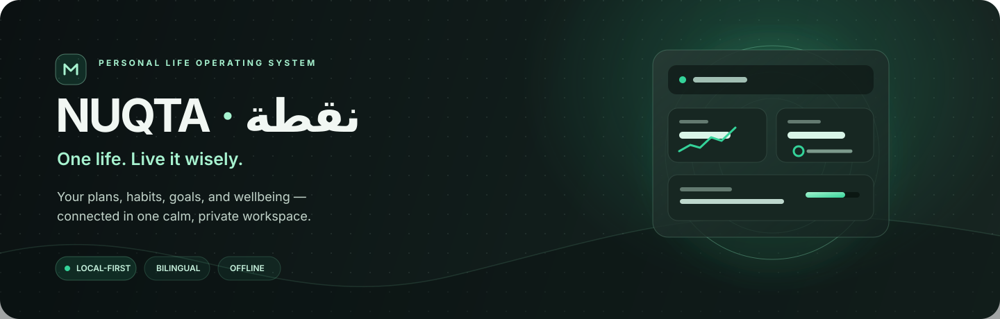
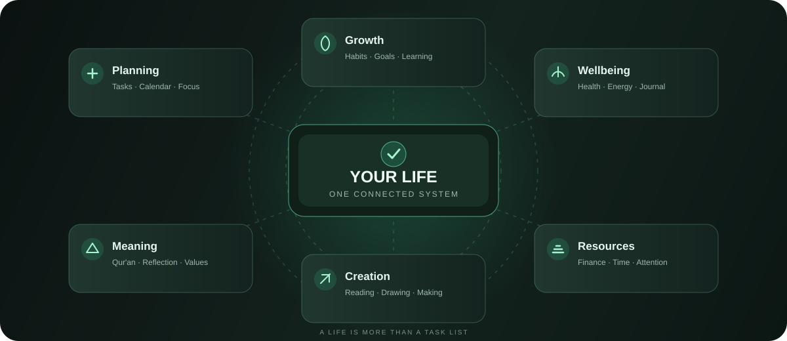
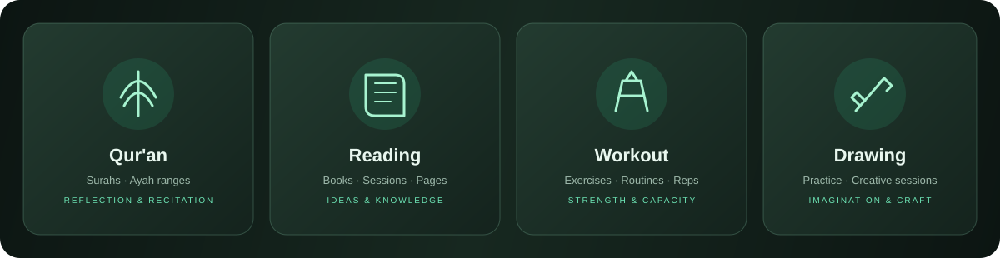
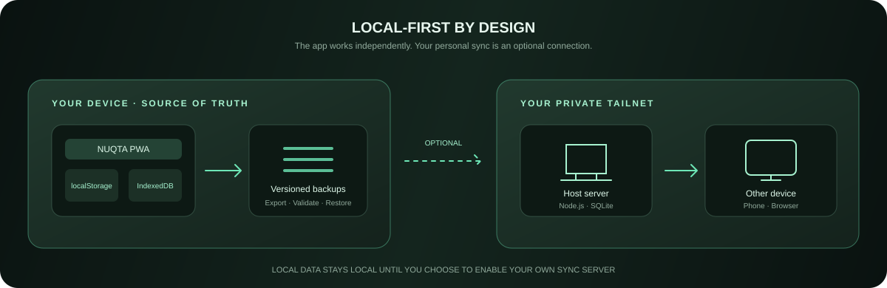

<div align="center">



<br />

**A local-first life operating system**

Bring your plans, habits, goals, focus, wellbeing, and personal growth into one thoughtful workspace.

<br />

[](https://github.com/Auctros/NUQTA/actions/workflows/verify.yml)
[](https://react.dev/)
[](https://www.typescriptlang.org/)
[](https://vite.dev/)
[](https://web.dev/learn/pwa/)

<br />

[Explore the code](https://github.com/Auctros/NUQTA) · [Report an issue](https://github.com/Auctros/NUQTA/issues) · [Sync operations guide](docs/sync-operations.md)

<br />

*One life. Live it wisely.*

</div>

---

## The idea

Most productivity apps help you manage tasks. NUQTA is built around a bigger question:

**How do the things you do every day connect to the life you're trying to build?**

A task is an action. A habit is a pattern. A goal is a direction. Your energy, health, finances, learning, faith, and creative work are all parts of the same life — yet most tools scatter them across disconnected products.

NUQTA brings those pieces together. It connects execution to outcomes, gives you a clearer picture of your time and energy, and keeps your personal data under your control.

### What guides the product

| Principle | In practice |
| --- | --- |
| **Local-first** | The app works on your device without an account or a required backend. |
| **Whole-life thinking** | Planning, habits, goals, health, money, learning, faith, and creativity belong in one system. |
| **Meaningful progress** | Goals can reflect real activity instead of relying only on manually edited percentages. |
| **Calm, intentional UX** | The product should help you regain direction, not manufacture urgency or engagement. |
| **Data ownership** | Your data is portable, recoverable, and stored locally by default. Optional private sync is self-hosted. |

---

## One life, connected

<div align="center">



<sub>One workspace. Different dimensions of life. Progress that connects.</sub>

</div>

NUQTA is designed around the idea that personal progress is not a collection of isolated checkmarks. Planning creates action; repeated action becomes practice; practice compounds toward outcomes. The surrounding areas of life provide context for that journey.

## What you can do with NUQTA

<table>
<tr>
<td width="50%" valign="top">

### ◈ Plan your day
- Smart tasks, priorities, subtasks, and scheduling
- A focused **Top Three** for daily priorities
- Natural-language task capture
- Calendar and agenda views
- Command palette and global search

</td>
<td width="50%" valign="top">

### ◈ Build consistent habits
- Flexible schedules and completion history
- Streak tracking and streak freezes
- Habit-specific progress views
- Reminders and due-day awareness
- Dedicated spaces for meaningful routines

</td>
</tr>
<tr>
<td width="50%" valign="top">

### ◈ Make goals measurable
- OKR-style goals and key results
- Milestones and target dates
- Progress linked to tasks and habits
- Activity-driven progress for reading and workouts
- Manual progress when a result needs it

</td>
<td width="50%" valign="top">

### ◈ Understand your life
- Health, sleep, hydration, mood, and weight logs
- Daily energy scoring
- Personal finance and savings goals
- Journaling and weekly reflection
- Insights connecting behaviour, energy, and outcomes

</td>
</tr>
<tr>
<td width="50%" valign="top">

### ◈ Make room for deep work
- Dedicated focus sessions
- Daily deep-work targets
- Session history
- A calmer place to work on one thing at a time

</td>
<td width="50%" valign="top">

### ◈ Recover your direction
- **Sunday Ritual** for a guided weekly review
- **Rescue Mode** to rebuild an overloaded day around one anchor task
- Universal archive and change history
- What-If Simulator for exploring possible changes

</td>
</tr>
</table>

### Dedicated practice studios

Some activities deserve more than a checkbox. NUQTA includes specialized spaces for:

- **Qur'an** — surah-based progress and ayah ranges.
- **Reading** — books, sessions, pages, quotes, and reading targets.
- **Workout** — exercise library, routines, sessions, and reps.
- **Drawing** — a dedicated space for a consistent creative practice.

Progress from supported activities can feed into linked goals, helping the system connect practice with outcomes.

<div align="center">



<sub>Purpose-built spaces for the practices that matter.</sub>

</div>

---

## Your data, your devices

### Local-first by default

NUQTA does not require an account, a hosted backend, or an API key to work.

- **localStorage** is the authoritative local data source and supports synchronous startup.
- **IndexedDB** mirrors the saved data and provides a recovery path if the primary browser storage is lost.
- The app shell is an installable **Progressive Web App**. After its first successful load, the shell is cached for offline use.
- Backups use a versioned JSON format. Restore validates the backup before writing, creates a safety copy, and uses an all-or-nothing recovery flow.
- A first run starts empty. Sample data is optional and must be requested from Settings.

<div align="center">



<sub>Your device remains the home of your data. Sync is an optional bridge — never a dependency.</sub>

</div>

### Optional private device sync

If you want the same NUQTA data on more than one device, an optional self-hosted sync layer is available.

- A small Node.js server serves the built app and sync endpoints.
- Changes are exchanged over WebSocket, with a durable outbox and server acknowledgements.
- SQLite stores the server-side change log.
- Tailscale Serve provides HTTPS and the authenticated Tailscale identity.
- Without `VITE_NUQTA_SYNC_URL`, sync stays inactive and the app remains local-first.

This is designed for a personal host and your own Tailnet — **not a required cloud service**.

> **Security boundary:** the sync server binds to `127.0.0.1` and trusts the identity header supplied by Tailscale Serve. Never expose its port directly to a LAN or the public internet, and never put it behind an untrusted reverse proxy. Read the [Sync Operations Guide](docs/sync-operations.md) before enabling it.

**Current sync limitation:** simultaneous edits to the same record are not automatically semantically merged. Treat sync as a way to move changes between your devices, not as a collaborative multi-user editing system.

---

## Quick start

### Requirements

- **Node.js 22** (the version used by the repository's CI workflow)
- npm

### Run locally

```bash
git clone https://github.com/Auctros/NUQTA.git
cd NUQTA

npm ci
npm run dev
```

Open **http://localhost:3000**.

No account, API key, or environment file is needed for local-only use.

### Available commands

| Command | What it does |
| --- | --- |
| `npm run dev` | Start the Vite development server |
| `npm run build` | Build the production app into `dist/` |
| `npm run preview` | Preview the production build |
| `npm run lint` | Run the TypeScript check |
| `npm test` | Run unit and integration tests |
| `npm run verify` | Run type-check, tests, build, and project invariants |
| `npm run test:e2e` | Run browser-level acceptance checks |
| `npm run verify:full` | Run the full verification gate, including browser checks |
| `npm run clean` | Remove generated build output |

Before submitting a change, run:

```bash
npm run verify
```

For the full browser-level gate:

```bash
npm run verify:full
```

---

## Enabling private sync

Sync is optional. Keep it disabled if you only need one device.

For a self-hosted setup:

1. Configure Tailscale on the host and the devices that should sync.
2. Copy `.env.example` to `.env`.
3. Set `VITE_NUQTA_SYNC_URL` to the same HTTPS origin that will serve the app.
4. Set `NUQTA_SYNC_ALLOWED_USERS` to the exact Tailscale login identities allowed to sync.
5. Set `NUQTA_SYNC_ALLOWED_ORIGINS` to the matching HTTPS origin.
6. Build the app, then start the loopback-only server.
7. Expose that local server through **Tailscale Serve**, not through a public tunnel or port forwarding.

Example host commands:

```bash
npm ci
npm run build
node --env-file=.env scripts/serve-dist.mjs
```

In a second terminal:

```bash
tailscale serve --bg 3000
tailscale serve status
```

The `VITE_*` value is compiled into the frontend at build time. If you change it, rebuild the app.

The complete setup, health checks, failure modes, and recovery notes are documented in **[docs/sync-operations.md](docs/sync-operations.md)**. The message and cursor model is described in **[docs/sync-protocol.md](docs/sync-protocol.md)**.

---

## Under the hood

### Technology

| Layer | Technology |
| --- | --- |
| UI | React 19 |
| Language | TypeScript |
| Build tooling | Vite 8 |
| Styling | Tailwind CSS 4 |
| State | Zustand 5 |
| Local persistence | localStorage + IndexedDB |
| Sync transport | WebSocket + HTTP delta recovery |
| Sync server | Node.js + SQLite |
| Testing | Vitest, Testing Library, Playwright |

### Project map

```text
NUQTA/
├── .github/workflows/       # CI verification and demo deployment
├── docs/
│   ├── sync-operations.md   # Self-hosted sync setup and operations
│   └── sync-protocol.md     # Implemented sync protocol
├── public/                  # PWA manifest, service worker, icons, assets
├── scripts/
│   ├── sync/                # Sync server, auth, database, validation
│   ├── serve-dist.mjs       # Production app + sync server entry point
│   └── check-invariants.mjs # Architectural guardrails
├── src/
│   ├── components/          # Screens, studios, shared UI, charts
│   ├── lib/                 # Domain engines, persistence, PWA, sync
│   ├── store/               # Application state and actions
│   └── types/               # Domain models
└── tests/                   # Unit and integration coverage
```

### A few important implementation choices

- **Local calendar dates stay local.** Calendar-day keys are not derived from UTC timestamps, avoiding off-by-one errors around midnight.
- **Persistence is deliberate.** Reads do not invent data; unreadable records are quarantined rather than silently overwritten.
- **Backups are validated before restore.** A malformed or incompatible backup should not partially replace the current dataset.
- **Sync is acknowledgement-driven.** Outbox entries are retained until the server explicitly acknowledges them; reconnect recovery pulls missed changes.
- **The local app remains useful without sync.** Sync configuration is opt-in, not a prerequisite for the core experience.

---

## Privacy & honest security notes

NUQTA is designed to minimize unnecessary data exposure, but local-first does not automatically mean encrypted.

- By default, personal data stays in the browser profile on the device.
- The app does not require accounts, analytics, or third-party API keys.
- Fonts are self-hosted with the app rather than fetched from a font CDN.
- **Local browser data is not currently encrypted at rest.** AES-GCM/PBKDF2 primitives exist in the codebase, but they are not applied to the stored dataset.
- Optional sync sends selected changes to the personal sync server you configure. Its access control depends on the Tailscale Serve deployment and the server allow-list.
- Export a backup before clearing browser data, changing devices, or performing maintenance.

The goal is to be explicit about what is protected, where data lives, and what still needs care.

---

## Keyboard shortcuts

| Shortcut | Action |
| --- | --- |
| `Q` | Open Quick Capture |
| `Ctrl` / `⌘` + `K` | Open the command palette |
| `Ctrl` / `⌘` + `Shift` + `F` | Open global search |
| `Esc` | Close the sidebar |

---

---

<div align="center">

### NUQTA · نقطة

**One life. Live it wisely.**

*Build a life you don't need to escape from.*

[GitHub Repository](https://github.com/Auctros/NUQTA)

</div>
